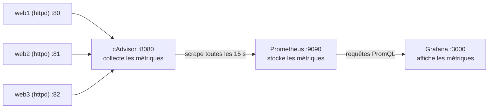

# Atelier Grafana 2026

Superviser des conteneurs Docker avec **cAdvisor**, **Prometheus** et **Grafana**, le tout dans un **GitHub Codespace**.

- **Durée indicative** : 1 h 30
- **Prérequis** : un compte GitHub, des notions de base sur Docker (`docker run`, `docker ps`)
- **Rien à installer sur votre poste** : tout se passe dans le navigateur

## Objectif

À la fin de l'atelier, vous aurez un tableau de bord Grafana qui affiche en temps réel la santé (CPU, mémoire, réseau) de trois serveurs web tournant dans des conteneurs Docker.

## Architecture



| Brique | Rôle | Port |
|---|---|---|
| `web1`, `web2`, `web3` | Les serveurs web Apache à superviser | 80, 81, 82 |
| cAdvisor | **Collecteur** : mesure la consommation de chaque conteneur et l'expose sur `/metrics` | 8080 |
| Prometheus | **Base de données de séries temporelles** : vient chercher (*scrape*) les métriques à intervalle régulier et les historise | 9090 |
| Grafana | **Visualisation** : interroge Prometheus et dessine les graphiques | 3000 |

> Retenez le principe : Prometheus fonctionne en mode **pull**. Ce n'est pas le collecteur qui envoie ses données, c'est Prometheus qui vient les lire.

---

## Étape 0 — Fork et Codespace

1. En haut à droite de ce dépôt, cliquez sur **Fork** pour en créer une copie dans votre compte.
2. Dans **votre** fork, cliquez sur **Code** → onglet **Codespaces** → **Create codespace on main**.
3. Patientez jusqu'à l'ouverture de VS Code dans le navigateur, puis vérifiez dans le terminal que Docker est disponible :

```bash
docker --version
```

### Accéder à un port depuis le navigateur

Dans un Codespace, `localhost` désigne la machine distante, pas votre poste. Pour ouvrir une interface web :

1. Ouvrez l'onglet **PORTS** (à côté de **TERMINAL**).
2. Repérez la ligne du port voulu et cliquez sur l'icône 🌐 (**Open in Browser**).

Si un port n'apparaît pas dans la liste, cliquez sur **Forward a Port** (ou **Add Port**) et saisissez son numéro.

---

## Étape 1 — Lancer les trois serveurs web

```bash
docker run -d --name web1 -p 80:80 quay.io/ocp-edge-qe/httpd
docker run -d --name web2 -p 81:80 quay.io/ocp-edge-qe/httpd
docker run -d --name web3 -p 82:80 quay.io/ocp-edge-qe/httpd
```

| Option | Signification |
|---|---|
| `-d` | Mode détaché : le conteneur tourne en arrière-plan |
| `--name web1` | Nom du conteneur ; c'est ce nom que vous retrouverez dans Grafana |
| `-p 81:80` | Le port 81 de l'hôte est redirigé vers le port 80 du conteneur |

**Vérification**

```bash
docker ps
curl localhost:80
curl localhost:81
curl localhost:82
```

Chaque `curl` doit répondre `<html><body><h1>It works!</h1></body></html>`.

---

## Étape 2 — Installer le collecteur cAdvisor

[cAdvisor](https://github.com/google/cadvisor) (*Container Advisor*) est un outil de Google qui mesure les ressources consommées par chaque conteneur et les publie au format Prometheus.

```bash
docker run -d --name cadvisor -p 8080:8080 \
  --privileged --device /dev/kmsg \
  -v /:/rootfs:ro \
  -v /var/run:/var/run:ro \
  -v /sys:/sys:ro \
  -v /var/lib/docker/:/var/lib/docker:ro \
  -v /dev/disk/:/dev/disk:ro \
  gcr.io/cadvisor/cadvisor:v0.55.1
```

Pourquoi autant de volumes ? cAdvisor tourne lui-même dans un conteneur, donc isolé. Pour observer les *autres* conteneurs, il doit pouvoir lire (en lecture seule, `:ro`) les informations de l'hôte :

| Volume | Ce que cAdvisor y lit |
|---|---|
| `/var/run` | Le socket Docker, pour connaître la liste et le nom des conteneurs |
| `/sys` | Les *cgroups*, où le noyau Linux comptabilise CPU et mémoire par conteneur |
| `/var/lib/docker` | Les données de Docker (couches, disque utilisé) |
| `/` et `/dev/disk` | Le système de fichiers et les disques de l'hôte |

> ⚠️ Gardez bien la version `v0.55.1`. Les versions plus anciennes (v0.52 et antérieures) ne savent pas lire le stockage d'images des versions récentes de Docker : cAdvisor démarre mais ne voit aucun conteneur.

**Vérification**

```bash
curl -s localhost:8080/metrics | grep 'container_memory_usage_bytes' | grep 'name="web'
```

Vous devez obtenir trois lignes, une par serveur web. Ouvrez aussi le port **8080** dans le navigateur pour découvrir l'interface de cAdvisor.

**Question** : à quoi ressemble une métrique Prometheus ? Repérez dans une ligne le *nom* de la métrique, ses *labels* (entre accolades) et sa *valeur*.

---

## Étape 3 — Installer Prometheus

### 3.1 Écrire le fichier `prometheus.yml`

Prometheus a besoin qu'on lui dise **où** aller chercher les métriques et **à quelle fréquence**. C'est le rôle de son fichier de configuration.

Créez un fichier `prometheus.yml` à la racine du dépôt :

```yaml
global:
  scrape_interval: 15s

scrape_configs:
  - job_name: "prometheus"
    static_configs:
      - targets: ["localhost:9090"]

  - job_name: "cadvisor"
    static_configs:
      - targets: ["host.docker.internal:8080"]
```

Lecture du fichier :

| Clé | Explication |
|---|---|
| `global` | Réglages appliqués par défaut à tous les jobs |
| `scrape_interval: 15s` | Prometheus interroge chaque cible toutes les 15 secondes. Plus l'intervalle est court, plus les courbes sont précises, mais plus le stockage grossit |
| `scrape_configs` | La liste des *jobs*, c'est-à-dire des familles de cibles à superviser |
| `job_name` | Nom libre du job. Il devient le label `job="..."` sur toutes les métriques collectées |
| `static_configs` / `targets` | La liste des adresses `hôte:port` à interroger. Prometheus ajoute lui-même le chemin `/metrics` |

Deux jobs sont déclarés :

- **`prometheus`** : Prometheus se supervise lui-même. Ici `localhost` désigne bien le conteneur Prometheus.
- **`cadvisor`** : la cible qui nous intéresse. On ne peut **pas** écrire `localhost:8080`, car dans le conteneur Prometheus, `localhost` c'est Prometheus lui-même, pas cAdvisor. On passe donc par `host.docker.internal`, un nom qui désigne la machine hôte, sur laquelle le port 8080 de cAdvisor est publié.

> ⚠️ YAML est sensible à l'indentation : utilisez des espaces (pas de tabulations) et respectez les alignements.

### 3.2 Lancer Prometheus

Depuis la racine du dépôt :

```bash
docker run -d --name prometheus -p 9090:9090 \
  --add-host=host.docker.internal:host-gateway \
  -v "$(pwd)/prometheus.yml:/etc/prometheus/prometheus.yml:ro" \
  prom/prometheus
```

| Option | Signification |
|---|---|
| `--add-host=host.docker.internal:host-gateway` | Déclare dans le conteneur le nom `host.docker.internal`, qui pointe vers l'hôte |
| `-v "$(pwd)/prometheus.yml:..."` | Monte votre fichier à l'emplacement où Prometheus attend sa configuration |

**Vérification**

1. Ouvrez le port **9090** dans le navigateur.
2. Menu **Status** → **Target health** : les deux cibles `prometheus` et `cadvisor` doivent être à l'état **UP** (patientez une quinzaine de secondes).
3. Dans l'onglet **Query**, exécutez votre première requête PromQL :

```promql
container_memory_usage_bytes{name=~"web.*"}
```

Vous pouvez aussi vérifier en ligne de commande :

```bash
curl -s localhost:9090/api/v1/targets | grep -o '"health":"[a-z]*"'
```

> Après toute modification de `prometheus.yml`, relancez Prometheus pour qu'il relise sa configuration : `docker restart prometheus`.

---

## Étape 4 — Installer Grafana

```bash
docker run -d --name grafana -p 3000:3000 \
  --add-host=host.docker.internal:host-gateway \
  grafana/grafana
```

1. Ouvrez le port **3000** dans le navigateur.
2. Connectez-vous avec l'identifiant `admin` et le mot de passe `admin`.
3. Grafana propose de changer le mot de passe : vous pouvez cliquer sur **Skip** pour cet atelier.

---

## Étape 5 — Connecter la source de données Prometheus

Grafana ne stocke aucune métrique : il faut lui indiquer où les lire.

1. Menu de gauche → **Connections** → **Data sources** → **Add data source**.
2. Choisissez **Prometheus**.
3. Dans **Prometheus server URL**, saisissez :

```
http://host.docker.internal:9090
```

4. Tout en bas, cliquez sur **Save & test**.

Vous devez voir le message vert **Successfully queried the Prometheus API**.

> Même raisonnement qu'à l'étape 3 : `http://localhost:9090` ne fonctionnerait pas, car c'est le *serveur* Grafana (dans son conteneur) qui interroge Prometheus, pas votre navigateur.

---

## Étape 6 — Importer un tableau de bord

Inutile de tout construire à la main : la communauté publie des tableaux de bord prêts à l'emploi sur [grafana.com/grafana/dashboards](https://grafana.com/grafana/dashboards/), chacun identifié par un numéro.

1. Menu de gauche → **Dashboards** → **New** → **Import**.
2. Saisissez l'ID **`14282`** (*Cadvisor exporter*) puis cliquez sur **Load**.
3. Dans la liste déroulante **Prometheus**, sélectionnez votre source de données.
4. Cliquez sur **Import**.

Vous voyez maintenant le CPU, la mémoire et le trafic réseau de `web1`, `web2`, `web3` (ainsi que de `cadvisor`, `prometheus` et `grafana`).

Pour comparer, importez aussi l'ID **`193`** (*Docker monitoring*), qui propose une vue plus synthétique.

---

## Étape 7 — Faire bouger les courbes

Des serveurs au repos donnent des courbes plates. Générez du trafic sur `web1` uniquement :

```bash
while true; do curl -s localhost:80 > /dev/null; done
```

Laissez tourner une à deux minutes, observez le tableau de bord (réglez le rafraîchissement automatique sur **10s** en haut à droite), puis arrêtez avec `Ctrl+C`.

**Questions**

1. Quel conteneur voit son CPU et son trafic réseau augmenter ? Pourquoi pas les deux autres ?
2. Arrêtez un serveur avec `docker stop web2`. Que devient-il dans Grafana ? Et dans la page **Target health** de Prometheus, la cible `cadvisor` passe-t-elle à **DOWN** ? Expliquez.
3. Relancez-le avec `docker start web2`.

---

## Pour aller plus loin

- **Créer votre propre panneau** : dans un nouveau tableau de bord, ajoutez une visualisation avec la requête

  ```promql
  sum by (name) (rate(container_cpu_usage_seconds_total{name=~"web.*"}[1m]))
  ```

  Que fait `rate(...[1m])` ? Pourquoi ne pas afficher directement `container_cpu_usage_seconds_total` ?
- **Ajouter un quatrième serveur** `web4` sur le port 83. Faut-il modifier `prometheus.yml` ? Pourquoi ?
- **Créer une alerte** Grafana qui se déclenche quand un conteneur `web` dépasse un seuil de mémoire.
- **Tout décrire dans un `docker-compose.yml`** pour démarrer la pile complète en une seule commande.

---

## Dépannage

| Symptôme | Cause probable et solution |
|---|---|
| `docker: Error ... container name "web1" is already in use` | Le conteneur existe déjà. Supprimez-le avec `docker rm -f web1` puis relancez la commande |
| La cible `cadvisor` est **DOWN** dans Prometheus | Vérifiez l'adresse `host.docker.internal:8080` dans `prometheus.yml`, la présence de `--add-host` dans la commande `docker run`, et que cAdvisor tourne (`docker ps`) |
| Prometheus s'arrête aussitôt lancé | Erreur de syntaxe YAML. Lisez le message avec `docker logs prometheus` |
| `docker logs prometheus` indique que `prometheus.yml` est un répertoire | Le fichier n'existait pas au lancement, ou vous n'étiez pas à la racine du dépôt. Faites `docker rm -f prometheus`, vérifiez avec `ls prometheus.yml`, puis relancez |
| cAdvisor ne remonte aucun conteneur `web` | Vérifiez que vous utilisez bien l'image `v0.55.1` |
| Tableau de bord vide ou **No data** | Vérifiez la source de données choisie à l'import, la plage de temps (**Last 15 minutes**) et attendez une à deux minutes que des points soient collectés |
| Les conteneurs ont disparu de `docker ps` après une pause | Un Codespace inactif s'arrête, et ses conteneurs avec. Relancez-les : `docker start web1 web2 web3 cadvisor prometheus grafana` |
| Grafana affiche `origin not allowed` à la connexion | Relancez Grafana en ajoutant l'option `-e GF_SECURITY_CSRF_TRUSTED_ORIGINS="${CODESPACE_NAME}-3000.${GITHUB_CODESPACES_PORT_FORWARDING_DOMAIN}"` |

Commandes utiles pour diagnostiquer :

```bash
docker ps -a              # état de tous les conteneurs, y compris arrêtés
docker logs <nom>         # journaux d'un conteneur
```

---

## Nettoyage

```bash
docker rm -f web1 web2 web3 cadvisor prometheus grafana
```

Pensez aussi à **arrêter ou supprimer votre Codespace** depuis [github.com/codespaces](https://github.com/codespaces) pour ne pas consommer votre quota gratuit.
